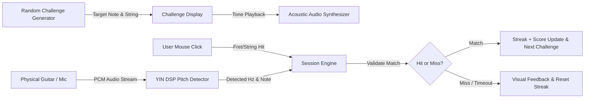
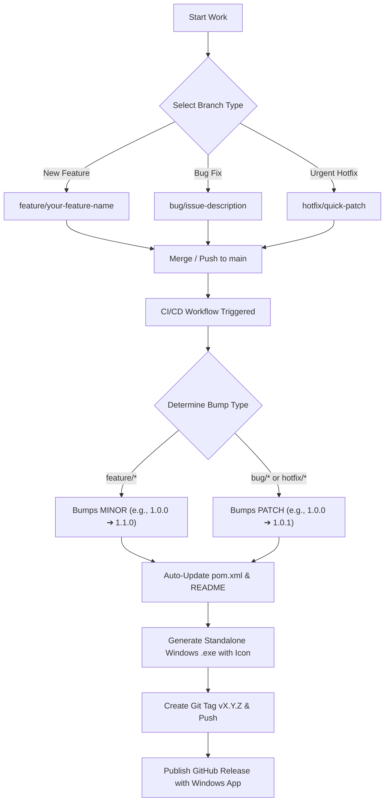

<div align="center">

# 🎸 Guitar Fretboard Trainer (ThreadBoardLearn)

**Next-Generation Desktop Trainer for Mastering Notes on the Guitar Fretboard**  
*Real-Time Microphone Pitch Detection (DSP) • Interactive Visual Neck • Gamified Practice Sessions*

<br/>

[](https://www.oracle.com/java/)
[](https://maven.apache.org/)
[](https://www.formdev.com/flatlaf/)
[](https://en.wikipedia.org/wiki/Pitch_detection_algorithm)
[](https://github.com/Gaboxondo/Fretboard--rainer)
[](LICENSE)

<br/>

[](https://github.com/Gaboxondo/Fretboard--rainer/releases/latest)
[](https://github.com/Gaboxondo/Fretboard--rainer/releases/latest)
[](https://github.com/Gaboxondo/Fretboard--rainer)
[](https://github.com/Gaboxondo/Fretboard--rainer)
[](https://github.com/Gaboxondo/Fretboard--rainer)
[](https://github.com/Gaboxondo/Fretboard--rainer)

<br/>

<a href="https://github.com/Gaboxondo/Fretboard--rainer/releases/latest">
  
</a>

<br/><br/>

**Language:** English • [Español (Spanish)](docs/es/README.md)

<p align="center">
  <a href="#quick-download">📥 Download</a> •
  <a href="#features">✨ Features</a> •
  <a href="#interface-preview">📸 Interface</a> •
  <a href="#quick-start">🚀 Quick Start</a> •
  <a href="#how-it-works">🧠 How it Works</a> •
  <a href="#auto-versioning">🔄 Versioning</a>
</p>

<br/>

<div id="interface-preview">
  
</div>

<br/>

| 🎸 6-String Diapason | 🎯 Real-Time Pitch DSP | 🌐 Dual Language (ES/EN) | 🏆 Gamified Streaks | 🎨 Dark Modern GUI |
| :---: | :---: | :---: | :---: | :---: |
| Proportional string gauges & frets | YIN autocorrelation algorithm | Built-in Spanish & English selector | Live score, streaks & reaction timer | Sleek FlatLaf Dark theme |

</div>

---

<a id="english"></a>
## 🌟 English Overview

### 💡 What is Guitar Fretboard Trainer?
**Guitar Fretboard Trainer** is a high-performance desktop application engineered with **Java 21**, **Swing (FlatLaf Dark)**, and real-time **DSP (Digital Signal Processing)**. It helps guitarists of all levels achieve instantaneous fretboard recall through randomized challenges and pitch detection with their actual physical instrument.

> **🌐 Multi-Language Ready**: Available out-of-the-box in two languages — **Spanish (Español)** and **English**. Switch between languages instantly with the top-bar dropdown without restarting.

Inspired by proven fretboard learning methodologies like [FaChords Guitar Fretboard Notes](https://www.fachords.com/guitar-fretboard-notes/), it pairs audio pitch analysis with an interactive visual fretboard to bridge the gap between theory and muscle memory.

---

<a id="features"></a>
### ✨ Key Features

- 🎤 **Real-Time Microphone Pitch Detection**: Connect an electric guitar through an audio interface or use an acoustic guitar with your laptop/desktop microphone. The embedded **YIN pitch detection algorithm** tracks the fundamental frequency (*f*₀) and validates your notes live.
- 🎸 **Interactive Vector Fretboard**:
  - Proportional string thicknesses (gauge rendering from 1st High E to 6th Low E).
  - Accurate fret markers at frets 3, 5, 7, 9 and double markers at fret 12.
  - Interactive mouse input: click notes directly on the diapason as an alternative to microphone input.
- 🔊 **Acoustic Reference Synthesizer**: Built-in tone generator with realistic acoustic harmonic decays to train your ear alongside your visual recognition.
- ⚙️ **Configurable Training Modes**:
  - **Strings**: Isolate individual strings (1st to 6th) or shuffle all strings randomly.
  - **Accidentals**: Toggle between Natural notes only (`A, B, C, D, E, F, G`) and Full Chromatic with Sharps (`#`).
  - **Countdown Timer**: 2s to 30s timers or untimed relaxed practice.
  - **Fret Neck Range**: Frets 0–12 (standard) or customized fret ranges.
  - **Anti-Vocal Noise & Noise Gate**: Filters voice frequencies and low-level room noise.
- 🧠 **Smart Adaptive Training Engine (Dynamic Probability Weighting)**: Rather than pure uniform randomness, the system dynamically recalculates selection probabilities based on your real performance. Notes you miss (wrong clicks or timeouts) or take longer to find are weighted higher and appear more frequently to accelerate muscle memory. As your recall speed and accuracy improve, weights decay back to baseline.
- 📊 **Visual Failure Analytics & Post-Session Results Dialog**:
  - **Single String Practice**: Generates an interactive bar chart of the notes with the most misses on that string with accuracy and average response times.
  - **All Strings Practice**: Displays a comparative bar chart across all 6 strings, explicitly highlighting the string with the highest mistake rate and top challenging notes.
  - **Smart Session Report**: Automatically opens at the end of practice (or via the `📊 Results` button) providing personalized pedagogical advice.
- 🌐 **Multi-Language Support (i18n)**: Instantaneous dynamic switching between English and Spanish via the top-bar selector without restarting the application.
- 🏆 **Gamified Analytics**: Real-time streak tracking, high scores, accuracy percentage, mistake counters, and average response times.


---

<a id="how-it-works"></a>
### 🧠 How It Works



1. **Challenge Generated**: A note (e.g., `G#`) and target string (e.g., `4ª D`) are selected.
2. **Audio Cue**: The synthesizer optionally sounds the reference frequency.
3. **Countdown**: The progress bar counts down your allotted time.
4. **Resolution**: Strike the note on your guitar or click the fretboard. When validated, the system rewards your streak and presents the next note.

---

<a id="musical-theory"></a>
### 🎵 Musical Foundations & Tuning Table

#### Standard Western Chromatic Scale (12 Semitones)

```
C  ➔  C♯ / D♭  ➔  D  ➔  D♯ / E♭  ➔  E  ➔  F  ➔  F♯ / G♭  ➔  G  ➔  G♯ / A♭  ➔  A  ➔  A♯ / B♭  ➔  B
```

> [!NOTE]
> Natural half-steps occur between **B & C** and **E & F** (there are no standard **B♯** or **E♯** notes).

#### Standard Guitar Tuning (EADGBE)
| String | Name | Note | Fundamental (*f*₀) | Octave Range |
| :---: | :---: | :---: | :---: | :---: |
| **6ª** | Low E | **E** | ~82.41 Hz | E2 |
| **5ª** | A | **A** | ~110.00 Hz | A2 |
| **4ª** | D | **D** | ~146.83 Hz | D3 |
| **3ª** | G | **G** | ~196.00 Hz | G3 |
| **2ª** | B | **B** | ~246.94 Hz | B3 |
| **1ª** | High E | **E** | ~329.63 Hz | E4 |

Each fret ascends by one chromatic semitone according to:

$$
f = f_{\text{open}} \cdot 2^{\frac{\text{fret}}{12}}
$$

---

<a id="technical-architecture"></a>
### 🏗️ Technical Architecture

```
com.threadboardlearn
├── App.java                      # FlatLaf Dark initialization & application entry
├── model/
│   ├── Note.java                 # Note enum with pitch, semitones, and accidental rules
│   ├── GuitarString.java         # 6-string physical representation & tuning references
│   ├── FretboardPosition.java    # Mapping of string + fret -> frequency & note
│   └── TrainingSessionConfig.java# Training parameters & preferences
├── audio/
│   ├── AudioPlayer.java          # Multi-harmonic acoustic tone synthesizer
│   └── MicrophoneCapture.java    # Non-blocking PCM TargetDataLine capture
├── dsp/
│   ├── PitchDetector.java        # Core DSP pitch detection interface
│   └── YinPitchDetector.java     # YIN autocorrelation algorithm implementation
├── engine/
│   ├── TrainingSession.java      # Session state, timers, streak tracking, and validation
│   ├── Challenge.java            # Individual challenge instance
│   ├── GameEventListener.java    # Reactive UI notification bridge
│   └── TrainingStats.java        # Performance statistics tracking
├── i18n/
│   ├── I18n.java                 # Central internationalization engine & listener bus
│   └── Language.java             # Supported locales (Spanish, English)
└── ui/
    ├── MainFrame.java            # Primary JFrame with language selector & high-DPI scaling
    ├── ChallengeDisplayPanel.java# Giant note typography & animated countdown bar
    ├── FretboardView.java        # Custom painted interactive fretboard component
    ├── ControlPanel.java         # Dropdowns, sliders, and audio device configuration
    └── StatusBar.java            # Real-time microphone monitor & performance metrics
```

---

<a id="quick-download"></a>
### 📥 Download & Install (Zero Configuration)

No technical knowledge or Java installation is required to run the desktop application!

| Platform | Package | How to Run | Link |
| :--- | :--- | :--- | :--- |
| **🪟 Windows (Recommended)** | **`FretboardTrainer-Setup.exe`** (~35 MB) | **Single `.exe`**: 1-click install, puts icon on Desktop & starts immediately | [⬇️ Download Windows Installer (.exe)](https://github.com/Gaboxondo/Fretboard--rainer/releases/latest) |
| **🪟 Windows (Portable)** | `FretboardTrainer-Windows.zip` | Extract zip & double-click `FretboardTrainer.exe` | [⬇️ Download Portable (.zip)](https://github.com/Gaboxondo/Fretboard--rainer/releases/latest) |
| **☕ Cross-Platform (macOS/Linux)**| `fretboard-trainer.jar` | Run with Java 21: `java -jar fretboard-trainer.jar` | [⬇️ Download JAR](https://github.com/Gaboxondo/Fretboard--rainer/releases/latest) |

> [!TIP]
> **Windows Users**: You only need to download **`FretboardTrainer-Setup.exe`**. It is a single, self-contained file with the embedded Java 21 runtime and custom icon. No folders to copy, no terminal, and no admin permissions required!

---

<a id="quick-start"></a>
### 🚀 Developer Quick Start

If you wish to build from source or contribute:

#### Prerequisites
- **JDK 21** or later ([Amazon Corretto 21](https://aws.amazon.com/corretto/), [Eclipse Temurin 21](https://adoptium.net/))
- **Apache Maven 3.8+**
- (Optional) Standard audio input microphone or guitar interface.

#### 1. Clone & Build
```powershell
git clone https://github.com/Gaboxondo/Fretboard--rainer.git
cd Fretboard--rainer
mvn clean package
```

#### 2. Run Application
```powershell
# Using Maven:
mvn exec:java -Dexec.mainClass="com.threadboardlearn.App"

# Or launch the compiled Fat JAR:
java -jar target/fretboard-trainer-1.6.1.jar
```

Alternatively, on Windows double-click **`run.bat`** or execute **`./run.ps1`**.

---

<a id="auto-versioning"></a>
### 🔄 Automated Versioning & Git Release Flow

The project follows strict **Semantic Versioning (SemVer)** automated via GitHub Actions:



#### Branch Naming Guidelines:
- **`feature/<name>`** or **`feat/<name>`**: Increments the **second number (Minor)** (`1.0.0` ➔ `1.1.0`). Use for new functionalities, game modes, or UI enhancements.
- **`bug/<name>`** or **`bugfix/<name>`**: Increments the **third number (Patch)** (`1.0.0` ➔ `1.0.1`). Use for bug fixes and corrective adjustments.
- **`hotfix/<name>`**: Increments the **third number (Patch)** (`1.0.0` ➔ `1.0.1`). Use for urgent production fixes.

---

<a id="android-version"></a>
### 📱 Android Version (Jetpack Compose)

This repository includes a native Android app in the [`android/`](android/) directory. It directly reuses the musical model, training engine, and YIN DSP pitch detection from `src/main/java`:

- **Touch Fretboard:** Interactive tactile guitar neck on mobile screens.
- **Microphone Input:** Real-time pitch detection with `AudioRecord` and the shared YIN algorithm.
- **Adaptive Training:** Same intelligent practice engine prioritizing challenging notes.

See [`docs/ANDROID.md`](docs/ANDROID.md) for architecture details and how to run in Android Studio.

---

## 📄 License
This project is licensed under the **MIT License** - see the [LICENSE](LICENSE) file for details.


