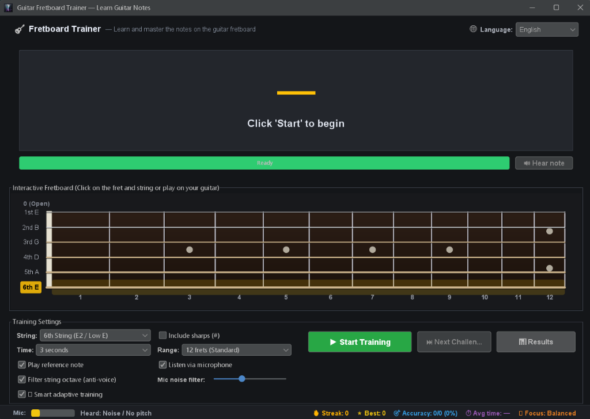
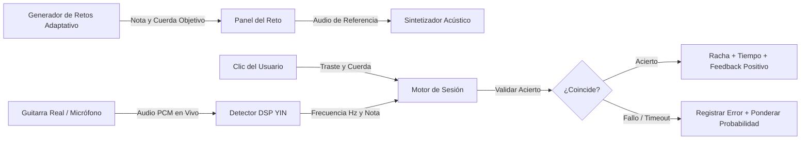
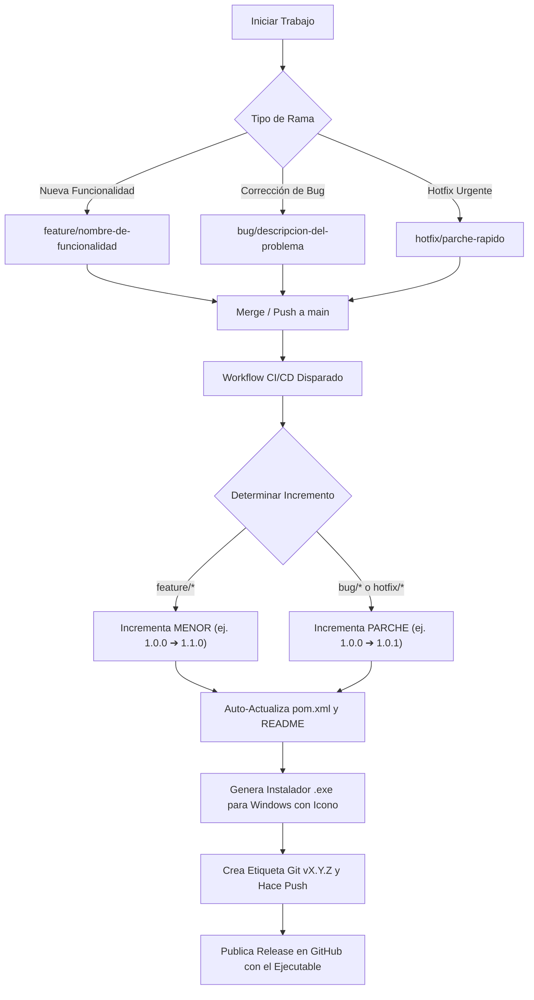

<div align="center">

# 🎸 Guitar Fretboard Trainer (ThreadBoardLearn)

**Entrenador de Escritorio de Última Generación para Dominar las Notas del Mástil de la Guitarra**  
*Detección de Tono por Micrófono en Tiempo Real (DSP) • Mástil Visual Interactivo • Sesiones de Práctica Gamificadas*

<br/>

[](https://www.oracle.com/java/)
[](https://maven.apache.org/)
[](https://www.formdev.com/flatlaf/)
[](https://en.wikipedia.org/wiki/Pitch_detection_algorithm)
[](https://github.com/Gaboxondo/Fretboard--rainer)
[](../../LICENSE)

<br/>

[](https://github.com/Gaboxondo/Fretboard--rainer/releases/latest)
[](https://github.com/Gaboxondo/Fretboard--rainer/releases/latest)
[](https://github.com/Gaboxondo/Fretboard--rainer)
[](https://github.com/Gaboxondo/Fretboard--rainer)
[](https://github.com/Gaboxondo/Fretboard--rainer)
[](https://github.com/Gaboxondo/Fretboard--rainer)

<br/>

<a href="https://github.com/Gaboxondo/Fretboard--rainer/releases/latest">
  
</a>

<br/><br/>

**Idiomas:** [English (Inglés)](../../README.md) • **Español**

<p align="center">
  <a href="#descarga-rápida">📥 Descarga</a> •
  <a href="#características">✨ Características</a> •
  <a href="#interfaz">📸 Interfaz</a> •
  <a href="#guía-rápida">🚀 Guía Rápida</a> •
  <a href="#cómo-funciona">🧠 Cómo Funciona</a> •
  <a href="#autoversionado">🔄 Versionado</a>
</p>

<br/>

<div id="interfaz">
  
</div>

<br/>

| 🎸 Diapasón de 6 Cuerdas | 🎯 DSP en Tiempo Real | 🌐 Selector Multiidioma (ES/EN) | 🏆 Rachas Gamificadas | 🎨 GUI Oscura Moderna |
| :---: | :---: | :---: | :---: | :---: |
| Calibres de cuerda y trastes proporcionales | Algoritmo de autocorrelación YIN | Selector en caliente Español e Inglés | Marcador en vivo, rachas y cronómetro | Elegante tema FlatLaf Dark |

</div>

---

<a id="descripción"></a>
## 🌟 Descripción General

### 💡 ¿Qué es Guitar Fretboard Trainer?
**Guitar Fretboard Trainer** es una aplicación de escritorio de alto rendimiento desarrollada con **Java 21**, **Swing (FlatLaf Dark)** y procesamiento digital de señales de audio en tiempo real (**DSP**). Su propósito es entrenar y acelerar la memorización visual y auditiva de las notas en el mástil de la guitarra mediante retos aleatorios y reconocimiento acústico de tu propio instrumento físico.

> **🌐 Preparado para Múltiples Idiomas**: Disponible de fábrica en dos idiomas: **Español** e **Inglés**. Permite alternar de idioma al instante desde el desplegable de la barra superior sin necesidad de reiniciar la aplicación.

Inspirado en metodologías consagradas de aprendizaje de la guitarra, combina el análisis de tono por micrófono con un diapasón interactivo para unir la teoría musical y la memoria muscular de tus dedos.

Permite responder de dos formas complementarias:
1. **Tocando tu guitarra real**: El micrófono capta la señal de audio y el algoritmo **YIN** reconoce la nota al instante.
2. **Haciendo clic en el diapasón interactivo**: Marca el traste y cuerda correspondiente directamente en la pantalla con el ratón.

---

<a id="características"></a>
### ✨ Características Principales

- 🎤 **Detección de Tono por Micrófono en Tiempo Real**: Conecta tu guitarra eléctrica mediante una interfaz de audio o toca una acústica/clásica usando el micrófono de tu ordenador. El algoritmo embebido **YIN** rastrea la frecuencia fundamental (*f*₀) y valida tus notas en tiempo real.
- 🎸 **Diapasón Vectorial Interactivo**:
  - Grosor de cuerdas proporcional (renderizado físico desde la 1ª aguda hasta la 6ª grave).
  - Marcadores de posición estándar (inlays) en los trastes 3, 5, 7, 9 y doble punto en el traste 12.
  - Clics directos en el mástil como alternativa táctica al micrófono.
- 🔊 **Sintetizador Acústico de Referencia**: Generador de tono armónico integrado para entrenar el oído musical junto al reconocimiento visual.
- ⚙️ **Modos de Práctica Flexibles y Configurables**:
  - **Cuerdas**: Entrena una cuerda aislada (de la 1ª a la 6ª) o activa todas las cuerdas aleatoriamente.
  - **Alteraciones**: Alterna entre solo notas naturales (`A, B, C, D, E, F, G`) y la escala cromática completa con sostenidos (`#`).
  - **Temporizador**: Retos de 3s a 15s o práctica relajada sin límite de tiempo.
  - **Rango del Mástil**: 12 trastes estándar, 15 trastes o 24 trastes completos.
  - **Puerta de Ruido y Filtro Anti-Voz**: Ignora conversaciones y ruidos transitorios en la habitación.
- 🧠 **Motor de Práctica Adaptativa Inteligente (Probabilidad Ponderada)**: En lugar de aleatoriedad uniforme, el sistema recalcula dinámicamente las probabilidades de selección en base a tus puntos débiles. Si fallas una nota (clics erróneos o tiempo agotado) o tardas más de lo habitual en encontrarla, esa nota incrementa su peso y aparece con mayor frecuencia. Conforme aciertas con rapidez, las penalizaciones decaen volviendo al equilibrio.
- 📊 **Gráficos de Análisis de Fallos y Diálogo de Resultados**:
  - **Modo Cuerda Única**: Gráfico de barras detallado con las notas más falladas en dicha cuerda, porcentaje de aciertos y tiempo de respuesta medio.
  - **Modo Todas las Cuerdas**: Comparativa simultánea entre las 6 cuerdas destacando la cuerda con mayor índice de error y las notas más desafiantes.
  - **Informe de Fin de Sesión**: Se abre automáticamente al pausar el entrenamiento (o mediante el botón `📊 Resultados`) ofreciendo consejos pedagógicos inteligentes y métricas clave.
- 🌐 **Soporte Multiidioma (i18n)**: Alternancia inmediata entre Español e Inglés mediante el selector de la barra superior.
- 🏆 **Métricas y Gamificación**: Racha de aciertos en vivo, récord de mejor racha, porcentaje de precisión, contador de fallos y tiempo de reacción medio.

---

<a id="cómo-funciona"></a>
### 🧠 ¿Cómo Funciona?



1. **Generación del Reto**: Se selecciona una nota (ej. `G#`) y una cuerda objetivo (ej. `4ª D`) aplicando los pesos adaptativos.
2. **Audio de Referencia**: El sintetizador puede hacer sonar la nota si la opción está activada.
3. **Cuenta Regresiva**: La barra de tiempo decrece según el límite configurado.
4. **Resolución**: Toca la nota en tu guitarra física o haz clic en el diapasón. Al validar, el sistema premia tu racha y pasa al siguiente reto.

---

<a id="fundamentos-musicales"></a>
### 🎵 Fundamentos Musicales y Tabla de Afinación

#### Escala Cromática Occidental Estándar (12 Semitonos)

```
C  ➔  C♯ / D♭  ➔  D  ➔  D♯ / E♭  ➔  E  ➔  F  ➔  F♯ / G♭  ➔  G  ➔  G♯ / A♭  ➔  A  ➔  A♯ / B♭  ➔  B
```

> [!NOTE]
> Los semitonos naturales ocurren entre **B y C** y entre **E y F** (no existen notas estándar **B♯** ni **E♯**).

#### Afinación Estándar de la Guitarra (EADGBE)
| Cuerda | Nombre | Nota | Fundamental (*f*₀) | Rango de Octava |
| :---: | :---: | :---: | :---: | :---: |
| **6ª** | Mi grave (Low E) | **E** | ~82.41 Hz | E2 |
| **5ª** | La (A) | **A** | ~110.00 Hz | A2 |
| **4ª** | Re (D) | **D** | ~146.83 Hz | D3 |
| **3ª** | Sol (G) | **G** | ~196.00 Hz | G3 |
| **2ª** | Si (B) | **B** | ~246.94 Hz | B3 |
| **1ª** | Mi agudo (High E) | **E** | ~329.63 Hz | E4 |

Cada traste asciende un semitono cromático exacto según la ley acústica:

$$
f = f_{\text{aire}} \cdot 2^{\frac{\text{traste}}{12}}
$$

---

<a id="arquitectura-técnica"></a>
### 🏗️ Arquitectura Técnica

```
com.threadboardlearn
├── App.java                      # Inicialización FlatLaf Dark y punto de entrada
├── model/
│   ├── Note.java                 # Enum de notas cromáticas con semitonos y alteraciones
│   ├── GuitarString.java         # Representación física de las 6 cuerdas y afinación
│   ├── FretboardPosition.java    # Mapeo de cuerda + traste -> frecuencia y nota
│   └── TrainingConfig.java       # Parámetros y preferencias de la sesión
├── audio/
│   ├── AudioPlayer.java          # Sintetizador multiarmónico de tonos acústicos
│   └── MicrophoneCapture.java    # Captura PCM no bloqueante por TargetDataLine
├── dsp/
│   ├── PitchDetector.java        # Interfaz de procesamiento digital de señales
│   ├── YinPitchDetector.java     # Implementación del algoritmo de autocorrelación YIN
│   └── PitchDetectionResult.java # DTO con frecuencia Hz, nota más cercana y cents
├── engine/
│   ├── TrainingSession.java      # Estado de sesión, temporizadores y coordinación
│   ├── Challenge.java            # Registro inmutable del reto actual
│   ├── GameEventListener.java    # Bus de eventos reactivo para la interfaz
│   ├── TrainingStats.java        # Estadísticas de sesión (aciertos, fallos, rachas)
│   ├── AdaptiveLearningEngine.java # Motor de probabilidad adaptativa ponderada
│   ├── NotePerformance.java      # Métricas de aprendizaje por nota
│   └── StringPerformance.java    # Métricas de fallos por cuerda
├── i18n/
│   ├── I18n.java                 # Motor central de internacionalización y listeners
│   └── Language.java             # Idiomas soportados (Español, English)
└── ui/
    ├── MainFrame.java            # Ventana principal, escalado de DPI y layout
    ├── ChallengeDisplayPanel.java# Tipografía gigante de nota e insignia de refuerzo
    ├── FretboardView.java        # Componente gráfico con renderizado de madera e inlays
    ├── ControlPanel.java         # Controles de audio, selector de cuerdas y botones
    ├── StatusBar.java            # Medidor VU, nota detectada en vivo y métricas
    ├── AnalyticsChartPanel.java  # Gráficos vectoriales de análisis de fallos
    └── SessionResultsDialog.java # Diálogo modal de resultados y consejos pedagógicos
```

---

<a id="descarga-rápida"></a>
### 📥 Descarga e Instalación (Zero Configuration)

¡No se requiere ningún conocimiento técnico ni tener Java instalado en tu ordenador!

| Plataforma | Paquete | Cómo Ejecutarlo | Enlace |
| :--- | :--- | :--- | :--- |
| **🪟 Windows (Recomendado)** | **`FretboardTrainer-Setup.exe`** (~35 MB) | **Instalador de 1 Clic**: Crea acceso directo en Escritorio y se ejecuta directamente | [⬇️ Descargar Instalador (.exe)](https://github.com/Gaboxondo/Fretboard--rainer/releases/latest) |
| **🪟 Windows (Portable)** | `FretboardTrainer-Windows.zip` | Descomprime el archivo y haz doble clic en `FretboardTrainer.exe` | [⬇️ Descargar Portable (.zip)](https://github.com/Gaboxondo/Fretboard--rainer/releases/latest) |
| **☕ Multiplataforma (macOS/Linux)**| `fretboard-trainer.jar` | Ejecuta con Java 21: `java -jar fretboard-trainer.jar` | [⬇️ Descargar JAR](https://github.com/Gaboxondo/Fretboard--rainer/releases/latest) |

> [!TIP]
> **Usuarios de Windows**: Solo necesitas descargar **`FretboardTrainer-Setup.exe`**. Es un archivo ligero e independiente con el entorno de Java 21 optimizado y su icono de guitarra. No necesitas permisos de administrador ni copiar carpetas a mano.

---

<a id="guía-rápida"></a>
### 🚀 Guía Rápida para Desarrolladores

Si deseas compilar desde el código fuente o contribuir al proyecto:

#### Requisitos Previos
- **JDK 21** o superior ([Amazon Corretto 21](https://aws.amazon.com/corretto/), [Eclipse Temurin 21](https://adoptium.net/))
- **Apache Maven 3.8+**
- (Opcional) Micrófono estándar o interfaz de audio con tu guitarra conectada.

#### 1. Clonar y Compilar
```powershell
git clone https://github.com/Gaboxondo/Fretboard--rainer.git
cd Fretboard--rainer
mvn clean package
```

#### 2. Ejecutar la Aplicación
```powershell
# Usando Maven:
mvn exec:java -Dexec.mainClass="com.threadboardlearn.App"

# O ejecutando el Fat JAR empaquetado:
java -jar target/fretboard-trainer-1.3.0.jar
```

En Windows también puedes hacer doble clic en **`run.bat`** o ejecutar en terminal PowerShell **`./run.ps1`**.

---

<a id="autoversionado"></a>
### 🔄 Versionado Automatizado y Ciclo de Release Git

El proyecto sigue el estándar de **Versionado Semántico (SemVer)** automatizado mediante GitHub Actions:



#### Convenciones de Nombres de Rama:
- **`feature/<nombre>`** o **`feat/<nombre>`**: Incrementa el **segundo dígito (Menor)** (`1.0.0` ➔ `1.1.0`). Usar para nuevas funcionalidades, modos de práctica o mejoras en la interfaz.
- **`bug/<nombre>`** o **`bugfix/<nombre>`**: Incrementa el **tercer dígito (Parche)** (`1.0.0` ➔ `1.0.1`). Usar para correcciones de bugs.
- **`hotfix/<nombre>`**: Incrementa el **tercer dígito (Parche)** (`1.0.0` ➔ `1.0.1`). Usar para parches críticos de producción.

---

## 📄 Licencia
Este proyecto está bajo la **Licencia MIT** - consulta el archivo [LICENSE](../../LICENSE) para más detalles.
